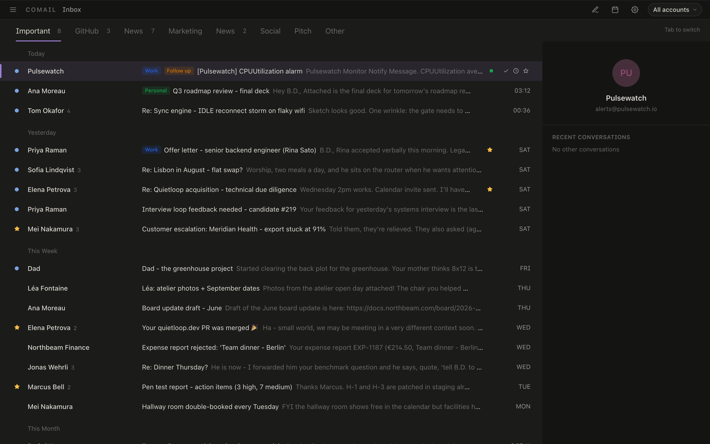
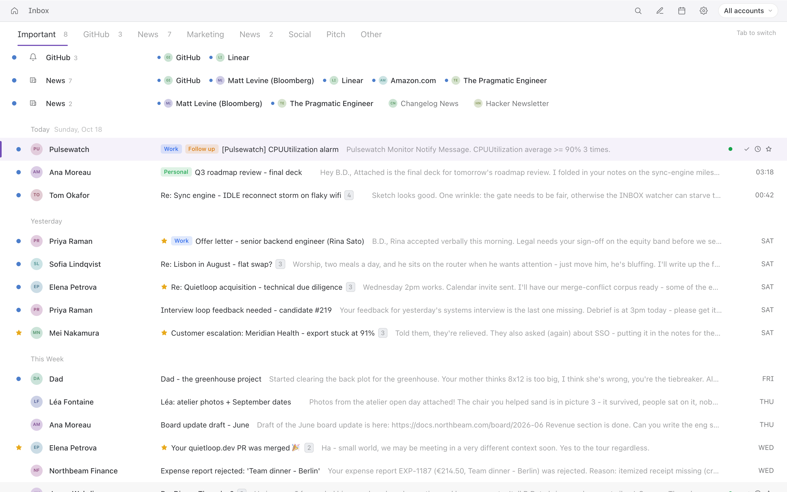
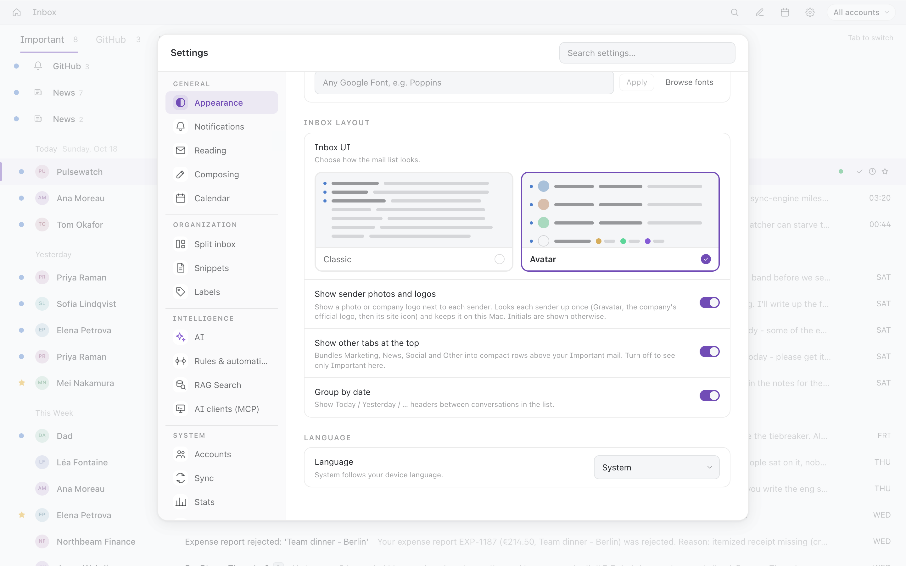
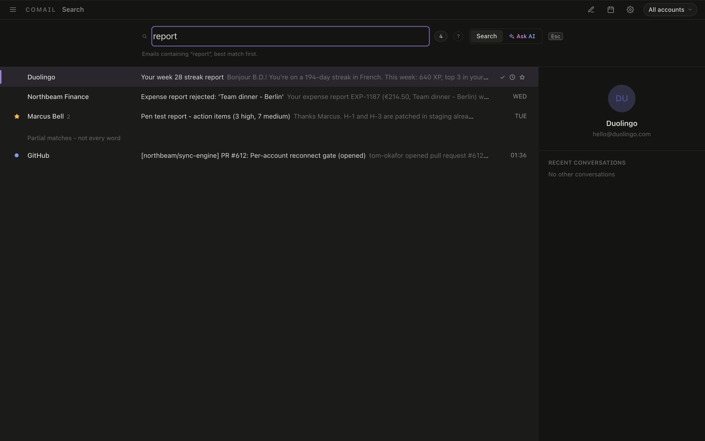
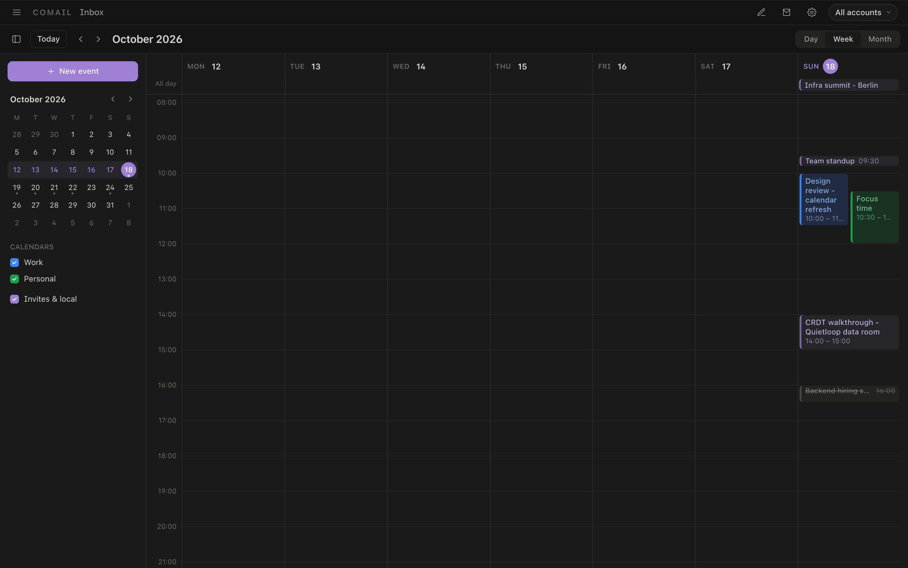
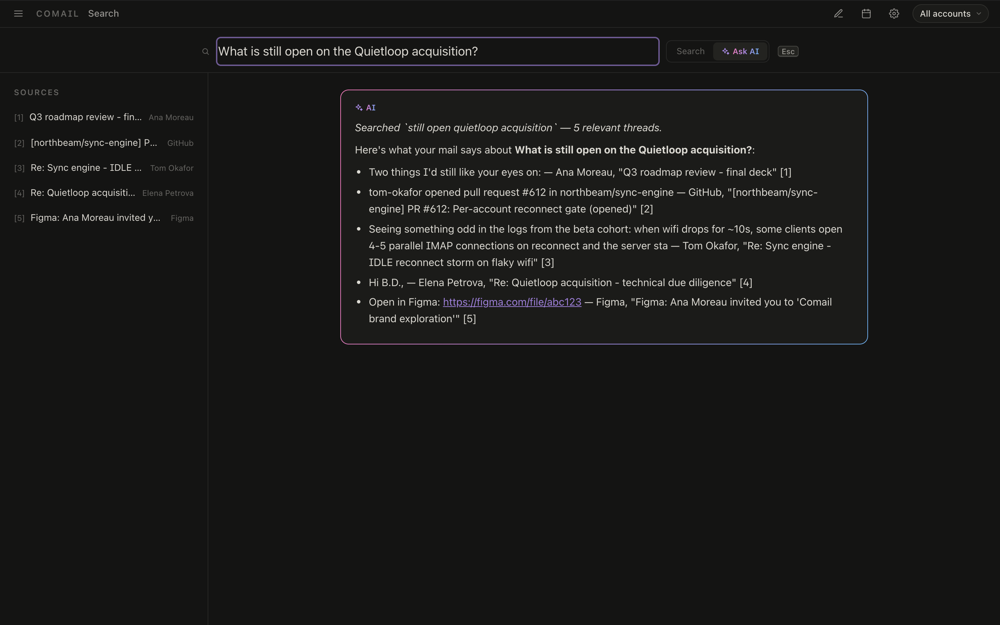
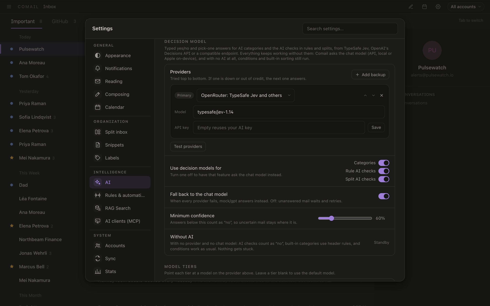
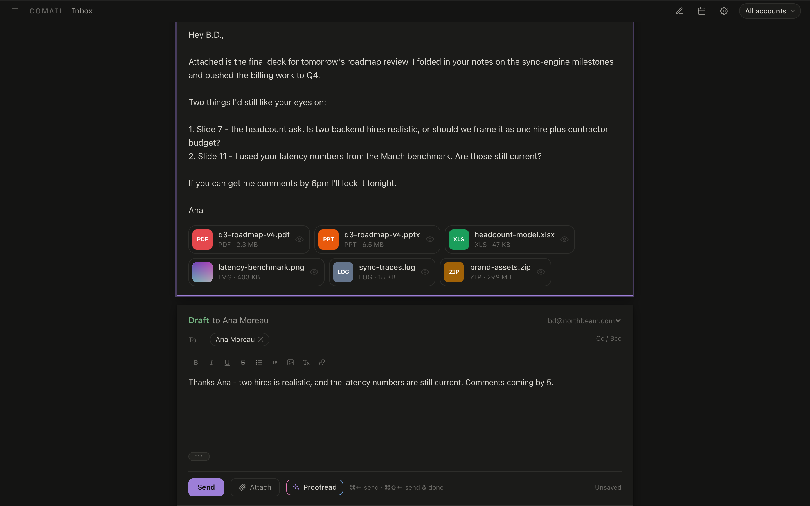

# Comail

Email that keeps up with you.

Comail is a fast, keyboard-driven mail client for Mac, Windows, and Linux. Your
whole mailbox lives on your computer, so everything opens instantly, search
finds what you *meant*, and it all keeps working on a plane. No account, no
subscription, no telemetry - free and open source.

[Download](https://github.com/NextOSP/comail/releases/latest) ·
[What's new](CHANGELOG.md) ·
[Report a bug](https://github.com/NextOSP/comail/issues)

<a href="https://www.producthunt.com/products/comail?embed=true&amp;utm_source=badge-featured&amp;utm_medium=badge&amp;utm_campaign=badge-comail" target="_blank" rel="noopener noreferrer"></a>



## Get Comail

Grab the installer for your platform from the
[latest release](https://github.com/NextOSP/comail/releases/latest):

- **macOS** - `.dmg` (universal, Apple Silicon and Intel)
- **Windows** - `.msi` or setup `.exe`
- **Linux** - `.deb` or `.AppImage`

Comail keeps itself up to date: it checks for new releases on launch and
installs them in place after asking you. See what changed in each version in
the [changelog](CHANGELOG.md).

Works with **Gmail**, **Microsoft 365 / Outlook**, and any **IMAP** provider
(Fastmail, iCloud, self-hosted, your company server). Regular IMAP accounts
just need an app password - no setup at all.

## Fly through your inbox

- **Everything is a keystroke.** `J`/`K` to move, `E` to mark done, `H` to
  snooze, `C` to compose, `?` shows every shortcut. Your hands never leave the
  keyboard.
- **A command palette for the rest.** `Cmd/Ctrl+K` finds any action by name - even plain language like "archive everything from LinkedIn" works.
- **Split inbox.** Important mail and everything else land in separate tabs,
  plus your own rules - newsletters, receipts, alerts - so the inbox you look
  at is only the mail that matters.
- **Snooze, send later, undo send.** Make mail come back when you can deal with
  it, schedule sends, and actually cancel a send you regret - the message
  doesn't leave for a few seconds, and Comail can really stop it.
- **Triage in bulk.** Select a batch with the keyboard or a drag, then archive,
  label, or snooze them all at once. Every action works offline and syncs when
  you're back.
- **Pick your inbox style.** Choose between a dense classic list and an avatar
  layout with sender photos and company logos, where your other tabs fold into
  compact bundles. Tabs with mail you haven't seen yet show a dot.



Switch layouts in **Settings > Appearance > Inbox layout** by clicking a
preview. In the same place you can turn sender photos on or off, decide whether
your other tabs appear as bundles above Important mail, and show or hide the
Today / Yesterday date headers.



### The shortcuts you'll use most

| Key | Action | Key | Action |
| --- | --- | --- | --- |
| `J` / `K` | Next / previous thread | `C` | Compose |
| `E` | Mark done | `H` | Snooze |
| `/` | Search | `Cmd/Ctrl+K` | Command palette |
| `Cmd+U` | Unsubscribe | `Ctrl+1`-`9` | Switch account |
| `2` / `0` | Calendar / quick peek | `?` | Every shortcut |

## Search that finds it

- **Ask in your own words.** "What did Ana want changed on the roadmap deck"
  finds the right thread even if it never used those words. The understanding
  happens on your machine - nothing is sent anywhere.
- **Or be precise.** Instant keyword search with `from:`, `in:`, `is:unread`,
  `has:attachment`, `subject:`, `body:`, and `exclude:` filters, plus dates and
  sorting. Sender searches rank people you actually talk to first.
- **It learns what you mean.** Threads and senders you pick out of results
  rank higher next time. That history never leaves your device and you can
  clear it in Settings.
- **Ask AI about your inbox.** Optional: connect an AI and ask questions across
  your mail, with cited sources you can click straight into. On a Mac with
  Apple Intelligence (macOS 26+, Apple silicon) you can use Apple's on-device
  model instead - no key, no cost, nothing leaves your machine.



## All your accounts, one calm app

- **Every account in one place**, each with its own color so a multi-account
  setup never blurs into one anonymous pile. Jump to any account with
  `Ctrl+1`-`9`.
- **Conversations that read like conversations.** Threads stack up cleanly,
  replies happen inline right under the message, and snippets fill in the
  sentences you type every day.
- **Attachments without the detour.** PDFs, Word, Excel, PowerPoint, CSVs, and
  images preview right in the app. Alt-click opens them externally.
- **One-key unsubscribe.** `Cmd+U` on any newsletter, with true one-click
  unsubscribe where the sender supports it.
- **Verification codes, handled.** When a one-time code arrives, it appears in
  the notification and is copied to your clipboard. On a Mac, Universal
  Clipboard lets you paste it on your iPhone too.
- **Lives in the tray.** Keeps syncing after you close the window, shows an
  unread badge on the dock, and plays a short (optional) chime only for
  genuinely new mail - never for the backlog it downloads when you reopen it.

## A real calendar, built in

- **Day, week, and month views** one keystroke away (`2` full screen, `0` for a quick
  peek). Click or drag to create; drag to move and resize.
- **Type events like you'd say them.** "Lunch with Ana tuesday 12:30" becomes
  an event - timezone-aware, in any language with the optional AI.
- **Invites just work.** Meeting invitations show up as RSVP cards inside the
  thread; accepting, editing, or cancelling emails the attendees for you.
  Reminders arrive as native notifications, and you can paste your free slots
  into any email.
- **Syncs both ways** with Google Calendar, Microsoft 365, Fastmail, iCloud,
  or any CalDAV server. Edits made offline push when you reconnect.



## AI on your terms

All AI features are optional and work with any OpenAI-compatible provider -
including a local one like LM Studio. Bring your own key, pick which model
handles which job, or use none of it. On a Mac with Apple Intelligence, you can
use Apple's on-device model with no key at all.

- **Summaries** of long threads on one key.
- **Reply drafting in your voice**, learned from your own sent mail.
- **Proofreading** before you send.
- **Plain-language commands** and inbox Q&A with cited sources.
- **Siri and Shortcuts on macOS.** Ask Siri for your latest verification code,
  check unread mail, catch up, ask about your email, search, or start a new
  message.

### Automate the boring parts

Describe a workflow the way you'd say it and let it run on every new email:

- **Automations you write in plain language.** "When an email is an invoice from
  a vendor, add the Finance label, move it to Important, and prefix the subject
  with [INVOICE]." The AI only decides whether a message matches; Comail then
  runs the exact actions you configured, so nothing surprising ever happens to
  your mail. Before you save, it shows you what it understood and which actions
  it will take.
- **Rules that combine a condition and an AI check.** Match on sender,
  recipient, subject, label, automated mail, or attachments, combined with
  AND / OR / NOT, and optionally add a yes/no question for the AI ("It is an
  invoice or receipt from a vendor"). Conditions are checked locally and
  instantly. The AI is only asked about mail that passes them. Split inbox tabs
  can use the same AI checks.
- **Real actions on a match.** Route to any tab, add or remove your labels, star,
  mark read, archive, or trash. Re-run automations across mail you already have
  whenever you tweak a rule.
- **Local-only overlays.** An automation can add a subject prefix or a note to
  the body that only you see. The original message on the server is never
  touched, so nothing you do here can corrupt the real email.
- **Sort the rest into categories.** Mail that no deterministic rule catches can
  be read once by the model and filed into Marketing, News, Social, Pitch, or
  categories you define yourself. Decisions are cached by sender, so it only
  costs a look the first time you hear from someone.



### Decision models: fast, cheap answers for sorting

Sorting mail doesn't need a chat model that writes paragraphs. It needs a
reliable yes or no. Comail can send categories and the AI checks in rules and
splits to a **decision model**, which returns typed answers (yes/no with a
confidence score, or one pick from a list) instead of generated text:

- **Providers:** TypeSafe Jev through OpenRouter, OpenAI's Decisions API, or any
  compatible endpoint (both request formats are supported).
- **Backups in order.** Add as many providers as you like. They're tried top to
  bottom, so if one is down or out of credit, the next one answers.
- **Uncertain means no.** Answers below your minimum confidence (60% by
  default) count as "no", so mail Comail isn't sure about stays where it is.
- **Nothing depends on it.** If every decision provider fails, Comail asks your
  chat model instead (API, local, or Apple on-device). With no AI at all,
  conditions and the built-in sorting still run. A Test button checks each
  provider with one tiny question.

Set it up in **Settings > AI > Decision model**. An empty API key reuses your
main AI key, which works when that key is an OpenRouter key.



### Use your mail from Claude, ChatGPT, Cursor and other AI apps

Comail can run a local [MCP](https://modelcontextprotocol.io) server so the AI
tools you already use can search, read and draft email. Turn it on in
**Settings > AI clients (MCP)**. It listens on `127.0.0.1` only and requires an
access token.

- **One click to add.** Claude Code, Claude Desktop, Cursor, VS Code, Windsurf,
  Codex CLI, Gemini CLI, opencode and LM Studio are set up for you. Zed, Cline,
  Continue, Goose and any other MCP client get a config to paste. ChatGPT
  connects from the cloud, so it needs a tunnel; Settings has the steps.
- **You decide what they can do.** Searching and reading are always available
  and drafting is on by default. Organizing mail (archive, label, trash) and
  sending are each off until you turn them on. Sent mail still waits out your
  undo-send delay.
- **AI apps know how to use it.** When an app connects, comail tells it today's
  date, your accounts, what it may do, how search works and how to handle mail
  safely, followed by any rules you add in Settings. Ready-made prompts cover
  catching up, triage, finding an email, summarizing a thread, drafting a reply
  and verification codes (in Claude Code: `/mcp__comail__catch_up`).
- **See what happened.** Every tool call is listed under Recent activity.

Any MCP client can connect to `http://127.0.0.1:47823/mcp` with the header
`Authorization: Bearer <token>`. For example, with Claude Code:

```sh
claude mcp add --transport http --scope user comail http://127.0.0.1:47823/mcp \
  --header "Authorization: Bearer <token>"
```

## Private by design

- **Your mail stays on your machine** - the full mailbox syncs into a local
  database, and search (including the semantic kind) runs entirely on-device.
- **Credentials live in the OS keyring**, never in a file.
- **Offline is a feature, not an error.** Read, search, write, and triage with
  no connection; everything replays when you're back.
- **No account, no telemetry, no subscription.** Free software under the AGPL.

## Looks right anywhere

Snow and Carbon themes in light and dark, an accent color of your choice, a
typeface from a curated set or any Google Font, a UI in English, Spanish,
French, Chinese, and Vietnamese, and native builds for all three desktop
platforms. Conversations read as a clean stack with replies inline:



## A note on first launch

On macOS, open the `.dmg` and drag Comail into Applications. If your build
warns about an unidentified developer, right-click the app and choose Open once
(or run `xattr -dr com.apple.quarantine /Applications/Comail.app`). On Windows,
choose More info → Run anyway in SmartScreen.

## Gmail and Microsoft accounts

Gmail and Microsoft 365 sign in with OAuth using your own (free) app
registration - a one-time, ten-minute setup with a full walkthrough in
[docs/oauth-setup.md](docs/oauth-setup.md). Everyone else just uses an app
password.

## For developers

Comail is built on Tauri 2 - a Rust core with a React front end. Setup, tests,
architecture notes, and the release process live in
[docs/DEVELOPMENT.md](docs/DEVELOPMENT.md), with contribution conventions in
[CONTRIBUTING.md](CONTRIBUTING.md).

## Say hello

Got feedback, a bug, an idea, or just want to talk? Reach out at
[hello@deanoss.com](mailto:hello@deanoss.com). Bug reports and feature requests
are also welcome on the
[issue tracker](https://github.com/NextOSP/comail/issues).

## License

Comail is free software, released under the GNU Affero General Public License
v3.0. See [LICENSE](LICENSE).
